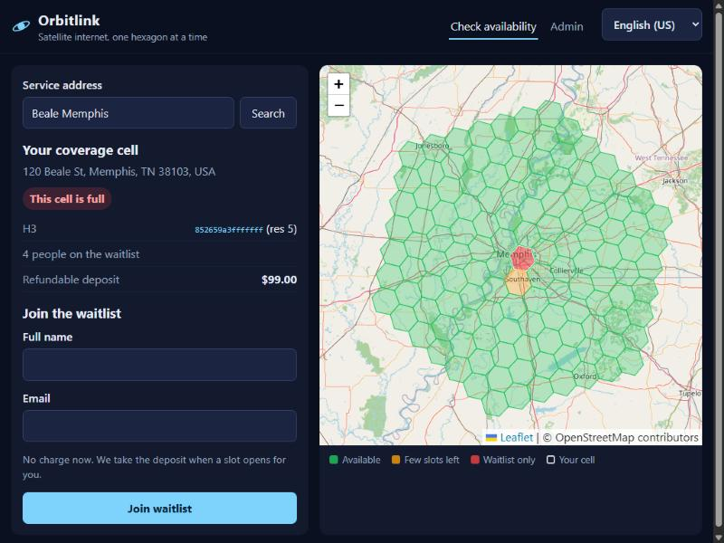
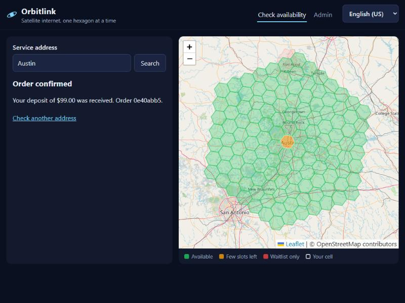
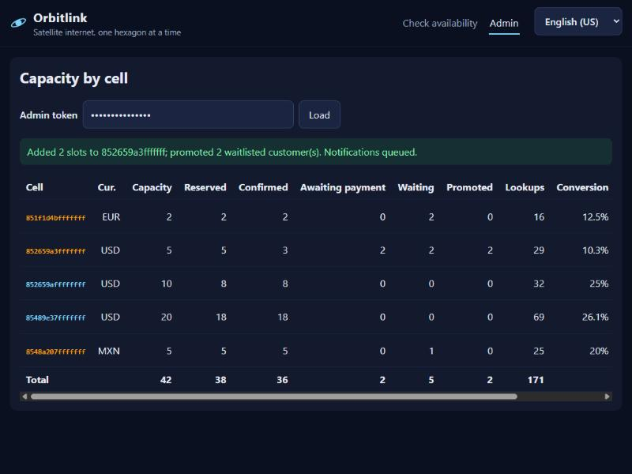
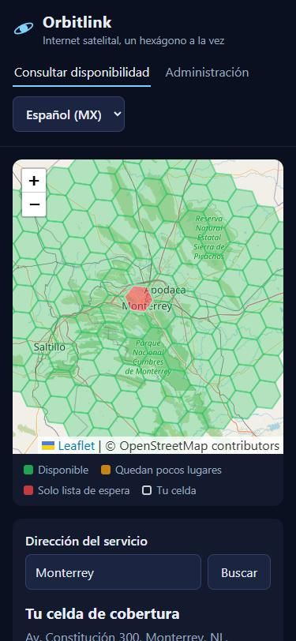
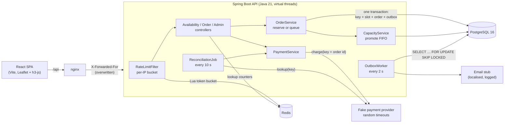

# Orbitlink signup

[](https://github.com/wallaceandrew9331-create/orbitlink-signup/actions/workflows/ci.yml)

A public signup and availability service for a fictional satellite internet provider, modelled on how Starlink-style services sell capacity: the world is cut into hexagonal cells, each cell has a finite number of slots, and when a cell is full new customers join a first-come-first-served waitlist.

The product is small. The point of the repo is the part that's hard to get right when a launch announcement sends thousands of people to the same page at once:

- **The last slot in a cell is never sold twice.** 500 concurrent orders at a 25-slot cell give exactly 25 orders and a waitlist numbered 1 to 475 ([`OversellIT`](backend/src/test/java/com/orbitlink/signup/orders/OversellIT.java)).
- **Retries and double-clicks create one order.** Order submission takes an `Idempotency-Key`. The deposit goes through a fake payment provider that times out on purpose, and a reconciliation job resolves the unknown outcomes.
- **The waitlist is strictly FIFO**, with no gaps or duplicates even when capacity is added concurrently.
- **Abuse protection:** Redis token buckets per IP and per account, plus input validation.
- **A launch-day load test** with measured latencies, the bottleneck found and what fixed it: [LOADTEST.md](LOADTEST.md).

Orbitlink is made up. This project isn't affiliated with or endorsed by SpaceX or Starlink.

| Full cell: join the waitlist | Order confirmed |
|---|---|
|  |  |

| Admin: add capacity, waitlist promoted | Mobile, Spanish (MX), MXN pricing |
|---|---|
|  |  |

## Architecture



An order request is two steps:

1. **One database transaction** claims the idempotency key, takes a slot (or a waitlist position), inserts the order or entry, and writes any notification to the outbox. All of it commits, or none of it does.
2. **After commit**, the deposit is charged with the order id as the provider's idempotency key. A slow or failing provider never holds a database lock or connection.

| Endpoint | Purpose |
|---|---|
| `GET /api/availability?lat&lng` | The cell for a point: status, slots left, waitlist depth, deposit and currency |
| `GET /api/cells?lat&lng&k` | Cells within `k` rings of a point, for the map (k ≤ 8) |
| `GET /api/geocode?q` | Fixture geocoder (see [Limitations](#limitations-and-next-steps)) |
| `POST /api/orders` + `Idempotency-Key` | Reserve and pay, or join the waitlist. 201 when created, 200 with `Idempotent-Replayed: true` on replay |
| `GET /api/orders/{id}` | Poll an order whose payment is pending |
| `POST /api/orders/{id}/pay` | Deposit for a customer promoted off the waitlist |
| `GET /api/admin/cells` | Capacity, reservations, waitlist depth, lookups and conversion per cell (bearer token) |
| `POST /api/admin/cells/{cell}/capacity` | Add slots; promotes waitlisted customers in order (bearer token) |

## Quick start

Needs Docker only.

```bash
docker compose up --build
```

- App: http://localhost:8083 (try "Memphis", "Austin", "Monterrey" or "Berlin", or click the map)
- Admin: http://localhost:8083/#/admin, token `dev-admin-token`
- API directly: http://localhost:8082

The demo seed fills a few cells so there's something to look at: downtown Memphis, Monterrey and Berlin are full with people waiting, and Southaven and Austin are nearly full. The test card `tok_decline` declines. About 10% of payments time out on purpose, so you'll sometimes see "Confirming your payment" until the reconciler settles it (within about 30 s).

### Tests

No local JDK is needed: [`backend/mvn.sh`](backend/mvn.sh) runs Maven in a container and mounts the Docker socket so Testcontainers can start Postgres and Redis.

```bash
./backend/mvn.sh verify          # 24 unit tests + 18 Testcontainers integration tests
cd web && npm ci && npm test     # vitest: i18n formatting, retry-with-same-key
./loadtest/run.sh baseline       # k6 launch-day spike against a fresh stack, then invariant checks
```

CI ([`.github/workflows/ci.yml`](.github/workflows/ci.yml)) runs the backend and web tests and builds both images.

## Design decisions and tradeoffs

### Locking: one conditional UPDATE

```sql
UPDATE cells SET reserved = reserved + 1 WHERE h3_index = ? AND reserved < capacity
```

The capacity check and the increment are one statement. Postgres locks the row before evaluating the `WHERE`. Under READ COMMITTED, a transaction that waited for that lock re-checks the condition against the row the previous holder committed. So when 500 requests race for the last slot, exactly one sees `reserved < capacity` and the rest update zero rows. Zero rows means "full", and the request moves on to the waitlist.

To check that the test would catch a race, I temporarily replaced this with the obvious read-then-write version (`SELECT reserved, capacity`, then `UPDATE … SET reserved = ?`). The three repetitions sold **494, 437 and 473 orders for 25 slots**. The `CHECK (reserved <= capacity)` constraint didn't help: lost updates kept the counter itself low while the orders piled up. The constraint stays in the schema as a backstop, but the conditional update is what prevents overselling.

Alternatives considered:

| Approach | Why not (here) |
|---|---|
| `SELECT … FOR UPDATE`, then decide in Java | Correct, and the same row lock, but one more round trip while holding it. I do use it where several statements must see one consistent cell (adding capacity, promotion). |
| `SERIALIZABLE` isolation | Correct, but contention shows up as serialization failures, so every caller needs a retry loop, and a hot cell retries a lot. |
| Optimistic `version` column | Same retry storm on a hot cell. It suits rarely-contended rows; a launch-day cell is the opposite. |
| Redis `DECR` counter | Fast, but the slot then lives in a different system from the order. A crash between the two leaks or double-counts slots, which brings back the problem the outbox solves, in a worse place. |
| One row per slot, `SKIP LOCKED` | Spreads lock contention across rows, but capacity changes now mean inserting and deleting rows, and the hot path is already cheap (see LOADTEST.md: lock waits were a small share at peak). |

The cost of this choice is that all orders in one cell serialise on one row. The load test measured how much that matters: at peak, row-lock waits were a small fraction of backend time, and WAL flushes and connection-pool queueing dominated.

### Waitlist fairness

- **Positions come from a counter on the cell row** (`waitlist_next`), not a Postgres sequence. Sequences aren't transactional: a join that rolls back would burn a number and leave a gap. The counter rolls back with the transaction, so positions are exactly 1..n.
- **A join only takes a position while the cell is full** (`… WHERE reserved >= capacity`). If a slot opens between a failed reserve and the join, the join matches no row and the request goes back to reserving. Nobody gets queued behind an empty slot.
- **Every path that frees capacity promotes in the same transaction**: an admin adding slots, a declined payment, or the reconciler giving up. That keeps one invariant true at every commit: *a cell with a free slot has an empty waitlist*. New orders can therefore take any free slot without jumping the queue. [`WaitlistFairnessIT`](backend/src/test/java/com/orbitlink/signup/orders/WaitlistFairnessIT.java) has 10 admins adding capacity while 100 customers join and checks that positions 1 to 50 were promoted and 51 to 300 are still waiting. [`loadtest/verify.sql`](loadtest/verify.sql) checks all of these invariants after every load run.

### Idempotency

- The key is claimed with `INSERT … ON CONFLICT DO NOTHING` **inside the order transaction**. If two requests with the same key arrive together, the second blocks on the unique index until the first finishes. If the first committed, the second sees the conflict and replays the stored result. If it rolled back, the second gets the key and does the work. So there's no "in progress" state to store, poll or expire.
- The key row stores a SHA-256 of the canonical request body. The same key with a different body is a client bug and gets **422**, not a silent replay of something else.
- The key points at the resource it created (order or waitlist entry), and a replay returns the resource's **current** state. A retry after a payment timeout therefore shows the order as it is now. If the payment is still pending, the retry asks the provider again with the same charge key, which can't double-charge. [`IdempotencyIT`](backend/src/test/java/com/orbitlink/signup/orders/IdempotencyIT.java) fires 30 identical requests at once and gets one 201, 29 replays and one order row.
- A fresh key with the same email in the same cell is a **409**: a partial unique index allows one live order per customer per cell. Keys expire after 24 h.
- The SPA keeps one key per distinct form submission and retries network errors and 5xx with it ([`api.ts`](web/src/api.ts)).

### Payments: outside the transaction, reconciled afterwards

The fake provider has two timeout modes that look the same to the caller: the request never arrived, or the card was charged and the response was lost. Because the caller can't tell which happened, the order goes to `PENDING` instead of guessing. The [`ReconciliationJob`](backend/src/main/java/com/orbitlink/signup/payments/ReconciliationJob.java) asks the provider what it recorded under the order's key:

- a result exists: apply it;
- nothing recorded: retry the charge, up to 3 attempts, then cancel and give the slot to the next person in line.

Status changes only fire from `RESERVED` (`UPDATE … WHERE status = 'RESERVED'`), so a late retry, a double-click and the reconciler can all race without double-confirming or releasing a slot twice.

### Why an outbox

Notifications ("you're #12", "a slot opened up") must go out **if and only if** the state change commits. Sending email inside the transaction would email people about promotions that then rolled back. Sending after commit loses the email if the process dies in between. So the message is a row written in the same transaction, and [`OutboxWorker`](backend/src/main/java/com/orbitlink/signup/outbox/OutboxWorker.java) delivers it afterwards:

- `FOR UPDATE SKIP LOCKED` lets several workers or replicas drain the table without blocking each other or sending the same row concurrently.
- Delivery is at least once: if the send succeeds but the commit fails, the row is sent again. The row id goes out as the message id so a real provider can dedupe.
- The email itself is a logged stub that renders the subject in the customer's locale.

### H3 resolution 5

Cells are H3 resolution 5: about 250 km² each, with edges of roughly 10 km.

- **Resolution 4** (~1,800 km²) puts a whole metro area in one or two cells. Capacity can't follow where people actually live, and a launch city becomes a single hot row.
- **Resolution 6** (~36 km²) means ~7× more cells to provision and display, most of them nearly empty outside cities, and a rural customer is often the only person in their cell.
- At 5, a metro area spans a handful to a few dozen cells, which spreads both capacity and lock contention, and the map shows a whole region in about 100 cells.

Hexagons rather than lat/lng squares because every neighbour is the same distance away and cell areas are roughly equal everywhere, so "N slots per cell" means about the same thing in Memphis and in Berlin. The resolution is one config value (`orbitlink.h3-resolution`). Changing it on a live system would mean migrating capacity between cell IDs, which this project doesn't attempt. Cells nobody has touched aren't stored: a lookup treats them as having the default capacity and never writes, and the first order creates the row.

### Rate limiting

- A token bucket in a Redis Lua script, so the read-refill-spend is atomic across API replicas. It uses Redis' own clock, so replicas with skewed clocks can't mint tokens.
- Per IP on the whole public API (40 burst, 10/s), and per account on order submission (5 burst, 1 per 10 s). The per-account bucket stops one email ordering from many addresses ([`RateLimitIT`](backend/src/test/java/com/orbitlink/signup/ratelimit/RateLimitIT.java)).
- **Fails open**: if Redis is down, requests are served without limits rather than turning a cache outage into a full outage.
- `X-Forwarded-For` is only trusted behind a proxy that overwrites it. nginx here sets it to `$remote_addr` rather than appending, so a client can't prepend a fake address.

### Internationalisation

- en-US and es-MX in the customer flow, with plural forms from `Intl.PluralRules`.
- Money comes from the API in **minor units** with an ISO currency. The deposit currency is a property of the cell (USD, MXN or EUR), not of the UI language. Formatting uses `Intl.NumberFormat` with the currency's own number of decimals, so the app never assumes two.
- Notification subjects are localised per customer. The admin page is English-only on purpose: it's an internal tool.

### Accessibility and mobile

- The address search is the primary, keyboard-accessible path; the map is a convenience.
- Labelled fields, `aria-invalid` and server-side field errors, focus moves to the result heading, and a skip link.
- 44 px touch targets, reduced-motion respected, and a single-column layout under 860 px with no horizontal scroll (checked at 375 px).

## Limitations and next steps

- **The geocoder is a fixture** of a dozen addresses, and the market (currency) comes from a rough outline of Mexico plus bounding boxes. A real service would call a geocoding provider and handle border areas properly.
- **Promoted customers hold their slot indefinitely.** A real waitlist offer would expire after a few days and pass to the next person. That's a scheduled job plus a status, built from parts already here.
- **The fake provider keeps its ledger in memory**, so it only works with one API replica. Everything else (row locks, SKIP LOCKED, Redis buckets) already works across replicas.
- **No customer accounts.** "Account" for rate limiting is the email address. Order ids are unguessable UUIDs, but anyone holding one can read that order.
- **Outbox retries have no backoff**: a failing row is retried every poll, up to 10 attempts.
- **The H3 bundle is large** (~590 kB of JS, mostly h3-js). Lazy-loading the map would cut the first load.
